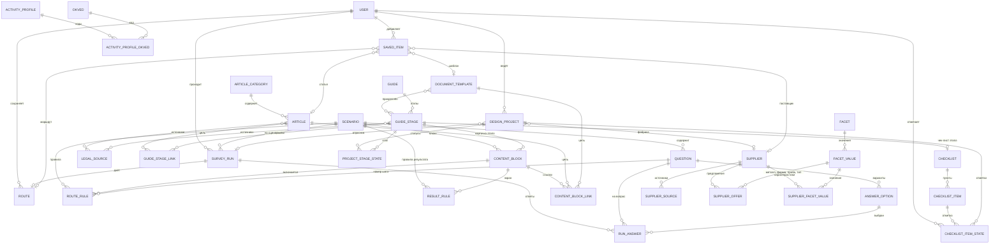

# Этап 3. Проектирование базы данных

Основание: файл «НОВАЯ СТРУКТУРА 12 окт.docx», `docs/01-requirements.md`, `docs/02-architecture.md`.
СУБД: PostgreSQL 16. ORM: Django. Названия в этом документе совпадают с именами моделей Django.

## 0. Принципы

1. **Логика лежит в данных.** Ветвление вопросов, выбор блоков маршрута и выбор экрана результата описаны условиями (JSONB) в таблицах. Автор контента правит их в админке Django.
2. **Один движок на три сценария.** «Открыть ювелирный бизнес», «Другой производитель предлагает похожие изделия» и «Реализовать готовый дизайн» (опросник из 7 вопросов) используют одни и те же таблицы `surveys` и `routes`.
3. **Результат сохраняется снимком.** `Route.snapshot` хранит готовый маршрут. Правка текста блока не меняет маршруты, которые пользователи уже получили.
4. **Гость и пользователь.** `SurveyRun.user` может быть пустым. Анонимный токен хранится только в виде хэша.
5. **Идентификаторы.** UUID у `SurveyRun`, `Route`, `DesignProject` (попадают в URL). У остальных числовой `id`, у контента ещё и `slug`.

## 1. Язык условий (JSONB)

Одна и та же запись используется в `Question.show_if`, `RouteRule.condition`, `ResultRule.condition`.

```json
{"all": [ ... ]}   // все условия верны
{"any": [ ... ]}   // верно хотя бы одно
{"not": { ... }}   // отрицание
```

Листовые условия:

| Условие | Смысл | Пример |
|---|---|---|
| `{"option": "q2.produce"}` | выбран вариант `<код вопроса>.<код варианта>` | ответ «Производить» на вопрос 2 |
| `{"tag": "obj:trademark"}` | среди выбранных вариантов есть вариант с таким тегом | выбран товарный знак |
| `{"answered": "q3"}` | на вопрос есть ответ | |
| `{"value": {"option": "grid.row3", "in": ["not_ready", "unknown"]}}` | значение строки в вопросе-таблице | этап 3 «Не готово» или «Не знаю» |

Пустое условие `{}` означает «всегда верно».

**Теги вариантов** (хранятся в `AnswerOption.tags`) нужны, чтобы правила работали по смыслу, а не по номерам вопросов. Примеры: `obj:industrial_design`, `obj:copyright`, `obj:trademark`, `reg:patent_yes`, `reg:patent_no`, `reg:tm_no`, `goal:fix`, `material:precious_metal`.

## 2. Сущности по приложениям

Тип `FK` означает внешний ключ. Поля `id`, `created_at`, `updated_at` есть у всех моделей и ниже не повторяются.

### 2.1. `accounts`

**User** (вход по email)

| Поле | Тип | Примечание |
|---|---|---|
| email | Email, unique | логин |
| password | хэш | |
| first_name | text | необязательно |
| is_active, is_staff | bool | `is_staff` даёт доступ в админку |

Refresh-токены хранит библиотека SimpleJWT (таблицы blacklist), своих таблиц не нужно.

### 2.2. `surveys`: движок опросов

**Scenario**

| Поле | Тип | Примечание |
|---|---|---|
| slug | unique | `open-business`, `ip-infringement`, `design-to-sale` |
| title, description | text | заголовок и описание страницы входа |
| is_published | bool | |

**Question**

| Поле | Тип | Примечание |
|---|---|---|
| scenario | FK Scenario | |
| code | text | `q2`, `q7_1`; unique вместе со scenario |
| step_label | text | номер шага в маршруте: «1», «7.1». Это не порядок показа |
| order | int | порядок обхода |
| text, help_text | text | формулировка и подсказка («Можно выбрать несколько») |
| kind | enum | `single`, `multi`, `status_grid` (вопрос-таблица 2Е) |
| is_required | bool | вопрос 7 из опросника можно пропустить |
| show_if | JSONB | условие показа, по умолчанию `{}` |

**AnswerOption**

| Поле | Тип | Примечание |
|---|---|---|
| question | FK Question | |
| code | text | unique вместе с question |
| label | text | |
| order | int | |
| tags | text[] | теги (GIN-индекс) |
| is_exclusive | bool | «Способ продажи еще не выбран» снимает остальные ответы |

Для `status_grid` каждая строка таблицы это `AnswerOption`, а статус строки хранится в `RunAnswer.value`.

**SurveyRun** (одно прохождение)

| Поле | Тип | Примечание |
|---|---|---|
| id | UUID PK | |
| scenario | FK Scenario | |
| user | FK User, null | пусто у гостя |
| anon_token_hash | text | хэш токена гостя |
| status | enum | `in_progress`, `completed` |
| completed_at | datetime, null | |

**RunAnswer**

| Поле | Тип | Примечание |
|---|---|---|
| run | FK SurveyRun, CASCADE | |
| question | FK Question | |
| option | FK AnswerOption | |
| value | text, null | только для `status_grid`: `ready`, `not_ready`, `unknown` |

Уникальность: `(run, option)`. Для множественного выбора на вопрос приходится несколько строк.

**Как движок выбирает следующий вопрос.** Берёт вопросы сценария по `order`, пропускает отвеченные и те, у которых `show_if` ложно, и возвращает первый оставшийся. Если таких нет, опрос окончен. Переходы вроде «если только продажа → вопрос 4» записываются как `show_if` у вопросов, а не как код.

### 2.3. `routes`: сборка результата

**ContentBlock** (кусок текста маршрута)

| Поле | Тип | Примечание |
|---|---|---|
| scenario | FK Scenario | |
| code | text, unique | `biz.q2.produce` |
| role | enum | `step` (блок «N шаг»), `result_screen`, `protection_method`, `stage_card` (карточка этапа гайда), `general` |
| title | text | |
| body | text | текст блока (Markdown) |
| guide_stage | FK GuideStage, null | для `stage_card`: на какую вкладку ведёт кнопка «Открыть этап N» |
| dedupe_key | text, null | один и тот же ключ нельзя вывести дважды (`stage:4`) |

**ContentBlockLink** (ссылки внутри блока)

| Поле | Тип | Примечание |
|---|---|---|
| block | FK ContentBlock | |
| order | int | |
| label | text | «Проверить виды деятельности» |
| kind | enum | `article`, `template`, `tool`, `catalog`, `external` |
| article | FK Article, null | |
| template | FK DocumentTemplate, null | |
| tool_slug | text | `okved-check`, `duty-calculator` |
| catalog_category | enum, null | `metals` или `stones` (каталог открывается на нужной вкладке) |
| url | text | для `external` |

Заполнено ровно одно из полей цели (проверяется в `clean()`). Статьи, которые автор ещё не написал, создаются как черновики (`is_published=false`), и ссылка не рвётся.

**RouteRule** (какие блоки попадают в маршрут)

| Поле | Тип | Примечание |
|---|---|---|
| scenario | FK Scenario | |
| block | FK ContentBlock | |
| condition | JSONB | когда включать блок |
| position | int | порядок внутри секции |
| step_question | FK Question, null | откуда берётся номер «N шаг» |
| promote_if | JSONB, null | если верно, блок идёт первым (выбранная цель защиты права) |

**ResultRule** (какой экран результата показать)

| Поле | Тип | Примечание |
|---|---|---|
| scenario | FK Scenario | |
| code | text | `ip.design_with_patent`, `ip.design_and_trademark`, `design.stage_3` |
| condition | JSONB | |
| priority | int | выигрывает правило с наибольшим приоритетом |
| screen_block | FK ContentBlock | экран результата или основная карточка этапа |

Комбинации объектов получаются приоритетом: «все три» (95) выше «две» (80), а «две» выше одиночных (50).

**Route** (сохранённый результат)

| Поле | Тип | Примечание |
|---|---|---|
| id | UUID PK | |
| run | OneToOne SurveyRun | |
| user | FK User, null | выставляется при привязке `claim` |
| scenario | FK Scenario | |
| result_code | text | какое `ResultRule` сработало |
| snapshot | JSONB | готовый маршрут: список блоков с текстом и разрешёнными ссылками |
| schema_version | int | версия формата снимка |

### 2.4. `content`: база знаний, чек-листы, гайд

**ArticleCategory**: `title`, `slug`, `order`.

**Article**

| Поле | Тип | Примечание |
|---|---|---|
| category | FK ArticleCategory | |
| kind | enum | `article`, `faq`, `glossary` |
| slug | unique | |
| title, summary, body | text | |
| is_published | bool | |
| search_vector | tsvector | полнотекстовый поиск, GIN-индекс |
| sources | M2M LegalSource | |

**LegalSource** (авторитетные источники, пункты И1–И8 из файла): `code`, `title`, `url`, `note`, `last_checked_at`. Поле `last_checked_at` нужно, потому что редактор должен проверять ссылки перед выпуском.

**DocumentTemplate**: `slug`, `title`, `description`, `file`, `format` (`docx`, `pdf`), `category`, `requires_login` (bool), `version`. Сюда относятся шаблон претензии, проект договора с изготовителем и другие.

**Guide** и **GuideStage** (10 вкладок «Путь от дизайна до продажи»)

| Модель | Поля |
|---|---|
| Guide | `slug` (`design-to-sale`), `title`, `intro` |
| GuideStage | `guide` FK, `number` (1–10), `title`, `action` (строка «Сохранить доказательства…»), `body` (Markdown), `expected_result`, `sources` M2M LegalSource, `templates` M2M DocumentTemplate (например, проект договора на вкладке 7) |

**GuideStageLink**: ссылки внутри этапа, поля те же, что у `ContentBlockLink`, плюс FK на `GuideStage`.

**Checklist** и **ChecklistItem**

| Модель | Поля |
|---|---|
| Checklist | `slug`, `title`, `goal` («Цель этапа»), `stage` OneToOne GuideStage, null (у отдельных чек-листов пусто) |
| ChecklistItem | `checklist` FK, `order`, `text`, `kind` (`task` или `criterion`, то есть пункт блока «Этап можно считать подготовленным, когда») |

Скачивание чек-листа в Word генерируется на лету из этих таблиц (python-docx), отдельная таблица для файла не нужна.

**ChecklistItemState** (отметки пользователя)

| Поле | Тип | Примечание |
|---|---|---|
| user | FK User | |
| project | FK DesignProject, null | пусто у отдельных чек-листов вне проекта |
| item | FK ChecklistItem | |
| is_checked | bool | |

Уникальность: `(user, project, item)` для строк с проектом и `(user, item)` для строк без проекта. Это два частичных `UniqueConstraint`, потому что в PostgreSQL значения NULL считаются различными.

**SavedItem** (избранное): `user` FK, и ровно один из `article`, `template`, `supplier`, `route` (FK, null). Уникальность по `(user, цель)`.

### 2.5. `projects`: «Мои проекты» (новое приложение)

В `docs/02-architecture.md` нужно добавить строку про это приложение: оно отвечает за сценарий «Реализовать готовый дизайн».

**DesignProject**

| Поле | Тип | Примечание |
|---|---|---|
| id | UUID PK | |
| user | FK User, CASCADE | |
| title | text | название дизайна |
| survey_run | FK SurveyRun, null | прохождение опросника, с которого начат проект |
| context | JSONB | материалы, страна изготовления, каналы продаж: нужны для пояснений внутри этапов 4–10 |
| supplier | FK Supplier, null | выбранная фабрика («Добавление фабрики в проект сохраняет ваш выбор») |
| notes | text | |

**ProjectStageState**

| Поле | Тип | Примечание |
|---|---|---|
| project | FK DesignProject, CASCADE | |
| stage | FK GuideStage | |
| status | enum | `not_started`, `in_progress`, `done_by_me`, `not_applicable` |

Уникальность: `(project, stage)`. Статус «Выполнено по моей проверке» ничего не подтверждает юридически, это отметка самого пользователя.

### 2.6. `catalog`: поставщики

**Supplier**

| Поле | Тип | Примечание |
|---|---|---|
| slug, name | text | |
| description | text | |
| website | URL | |
| categories | text[] | `metals`, `stones` |
| city | text | |
| is_manufacturer | bool | |
| requires_giis_registration | bool | покупатель должен быть в ГИИС ДМДК (как у Техномета) |
| tags | text[] | поле «Признаки» из файла, для поиска (GIN) |
| is_published | bool | |
| checked_at | date | когда данные проверены в последний раз |

**SupplierSource**: `supplier` FK, `label`, `url`.

**Facet**: справочник характеристик. Поля `code`, `title`, `applies_to` (`metals` или `stones`). Значения кодов: `metal`, `form`, `fineness`, `product_type`, `supply_terms`, `delivery`, `stone_type`, `stone_origin`, `cut`, `supply_format`.

**FacetValue**: `facet` FK, `code`, `label`, `order`.

**SupplierOffer** (предложение по металлам)

| Поле | Тип | Примечание |
|---|---|---|
| supplier | FK Supplier | |
| metal | FK FacetValue | золото, серебро и т. д. |
| form | FK FacetValue, null | слиток, проволока… |
| fineness | FK FacetValue, null | проба |
| product_type | FK FacetValue, null | |
| min_batch | text | «золото от 100 г» |

Благодаря этой таблице фильтр «Проба» зависит от металла: список проб строится из реальных предложений поставщиков по выбранному металлу.

**SupplierFacetValue**: `supplier` FK, `value` FK FacetValue. Здесь хранятся независимые характеристики: условия поставки, доставка, вид камня, происхождение, огранка, формат поставки.

### 2.7. `tools`: инструменты

**Okved**: `code` (unique), `title`.

**ActivityProfile** (модель ювелирного бизнеса для проверки): `slug`, `title`, `condition` (JSONB, по тем же тегам, что и в опросах), `description`.

**ActivityProfileOkved**: `profile` FK, `okved` FK, `relevance` (`required` или `recommended`), `comment`.

Проверка: пользователь выбирает модель бизнеса (или берёт её из пройденного опроса) и вводит свои коды. Результат: какие коды есть, каких не хватает, что рекомендовано.

**DutyRate**: `tn_ved_code`, `description`, `duty_percent`, `vat_percent`, `valid_from`, `valid_to`, `source_url`. Структура предварительная, пока не известен порядок расчёта (см. вопрос 4 ниже).

## 3. ERD

Для просмотра вставь блок в https://mermaid.live или открой файл в редакторе с поддержкой Mermaid.



`DUTY_RATE` самостоятельная таблица без связей и поэтому в диаграмму не включена.

## 4. Как сценарии из файла ложатся на схему

| Сценарий | Как реализуется |
|---|---|
| Бизнес: ответ даёт блок «N шаг» | `RouteRule` с условием `{"option": "q2.produce"}`; номер шага берётся из `step_question.step_label` |
| Бизнес: вопрос 3 только для производства | `Question.show_if = {"option": ...}` у вопроса 3 |
| Бизнес: множественный выбор (способы продажи) | несколько `RunAnswer` на один вопрос, в маршрут идут все подходящие правила |
| Бизнес: «Если выбрано несколько способов, добавляются все абзацы» | то же самое, дополнительного кода нет |
| Нарушение прав: несколько объектов сразу | теги `obj:*` и `ResultRule` с приоритетами (маршруты 4–7) |
| Нарушение прав: вопрос 2 показывает только релевантные варианты | три отдельных вопроса с `show_if` по тегу объекта |
| Нарушение прав: выбранная цель идёт первой в «Способах защиты» | `RouteRule.promote_if` |
| Нарушение прав: «Нет зарегистрированного товарного знака» | тег `reg:tm_no` и отдельное правило результата |
| Опросник дизайна: один основной этап и несколько связанных | основной через `ResultRule` (побеждает наивысший приоритет), связанные через `RouteRule` с `dedupe_key` |
| Опросник дизайна: вопрос-таблица 2Е со статусами | `Question.kind = status_grid`, значение в `RunAnswer.value` |
| Опросник дизайна: «Способ продажи еще не выбран» снимает остальные | `AnswerOption.is_exclusive` |
| Опросник дизайна: вопрос 7 можно пропустить | `Question.is_required = false` |
| Гайд из 10 вкладок, проект договора на вкладке 7 | `GuideStage`, `GuideStage.templates` |
| Чек-лист с четырьмя статусами, скачивание в Word | `Checklist`, `ProjectStageState`, генерация docx |
| «Мои проекты», выбранная фабрика | `DesignProject.supplier` |
| Каталог: проба зависит от металла | `SupplierOffer` и endpoint с доступными значениями фильтров |
| Сохранение после входа | `SurveyRun.user` пустой, затем `claim` привязывает прохождение и `Route` |
| Старые маршруты не меняются при правке текстов | `Route.snapshot` |

## 5. Индексы и ограничения

- GIN: `AnswerOption.tags`, `Supplier.tags`, `Article.search_vector`.
- Unique: `(scenario, code)` у `Question` и `ContentBlock`; `(question, code)` у `AnswerOption`; `(run, option)` у `RunAnswer`; `(project, stage)` у `ProjectStageState`; `(guide, number)` у `GuideStage`.
- `on_delete`: данные пользователя (`SurveyRun`, `Route`, `DesignProject`, `SavedItem`, `ChecklistItemState`) удаляются вместе с аккаунтом (CASCADE). Контент, на который ссылаются правила (`ContentBlock`, `Article`, `GuideStage`, `FacetValue`), защищён от удаления (PROTECT).
- Проверки в `clean()`: у `ContentBlockLink` и `GuideStageLink` заполнена ровно одна цель; у `SavedItem` ровно одна цель.

